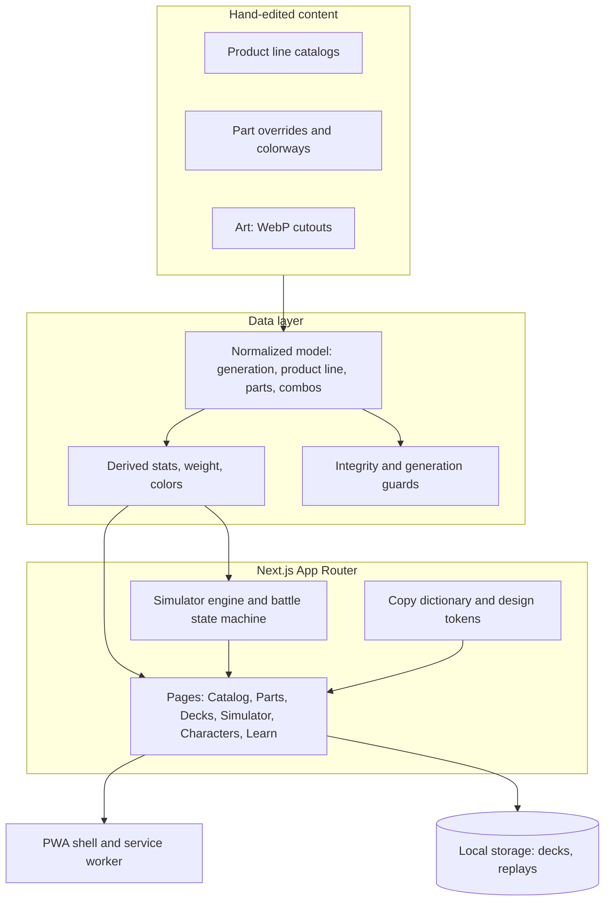

# BladerLab

A free, mobile-first Beyblade X companion: browse the catalog, build decks, assemble custom combos, and simulate battles before you launch.

> **The source code is private.** This repository is an overview only. It contains no code, art, or data from the app. Nothing here grants a license to use, copy, or redistribute BladerLab's code or content. All rights reserved.

## Status

BladerLab is an independent fan project. It is free to use, has no ads, and makes no money. It is not affiliated with, endorsed by, or sponsored by Takara Tomy, Hasbro, or any of their collaboration partners.

Beyblade, Beyblade X, and related names, logos, products, and characters are trademarks or copyrighted works of their respective owners. Product names and descriptions are used only to identify real products. Sources are credited on the site's Credits page. If you are a rights holder and want something changed or removed, please open an issue here or contact the maintainer and it will be handled promptly.

## What it does

- **Catalog:** every battle top, set, booster, and accessory, with parts, stats, release info, and art.
- **Parts:** blades, ratchets, bits, launchers, and colorways, with the tops that use each one.
- **Deck Builder and Saved Decks:** build and keep decks, with deck rules checked as you go.
- **Assemble:** mix parts into custom combos with derived stats and weight.
- **Simulator:** 1v1 and best-of-3 battles with a replay.
- **Characters:** the anime cast and collaboration partners, linked to the tops they use.
- **Learning Center:** guides and FAQ for every core page.
- **Installable PWA:** works offline for core pages, with an update banner on new releases.

## Architecture

### Design choices

- **Content as typed data.** The catalog is hand-edited TypeScript plus image files. A derivation layer builds the runtime model, so adding a product means editing one row, not many components.
- **One model for every generation.** X, Burst, Metal Fight, and Original share a single normalized shape. Generation differences live in one config row per generation, not in scattered conditionals.
- **Flat, id-based relations.** Products, parts, and characters link through ids and join tables, so the data stays easy to move into a database later.
- **Integrity checks at build time.** Guards fail loudly on unknown part ids, cross-generation parts, or products missing from the taxonomy.
- **Explicit state machines.** Battles, series, hero rotation, and toasts use named phases derived in one place, not piles of booleans.
- **Design tokens and a copy dictionary.** Every color, spacing value, and UI string goes through a token or the copy dictionary, which keeps themes and tone consistent.
- **Mobile first.** A 375px base layout, 44px touch targets, reduced-motion support, and pre-sized WebP art because images are served as-is.
- **Quality gates.** Scripted checks cover theme safety, catalog colors, logo sizes, docs sync, and clean diffs before every commit.

## Tech stack

| Area | Choice |
|------|--------|
| Framework | Next.js (App Router), React, TypeScript |
| Styling | Tailwind CSS with design tokens |
| Motion and 3D | Framer Motion, three.js |
| Hosting | Vercel |
| Offline | PWA with a service worker |
| Analytics | Cookieless, page views only |
| Tests | Playwright end to end, plus script-based gates |

## Contact

Rights-holder requests, corrections, and questions: open an issue on this repository.

&copy; BladerLab. All rights reserved. The app's code is not open source.
